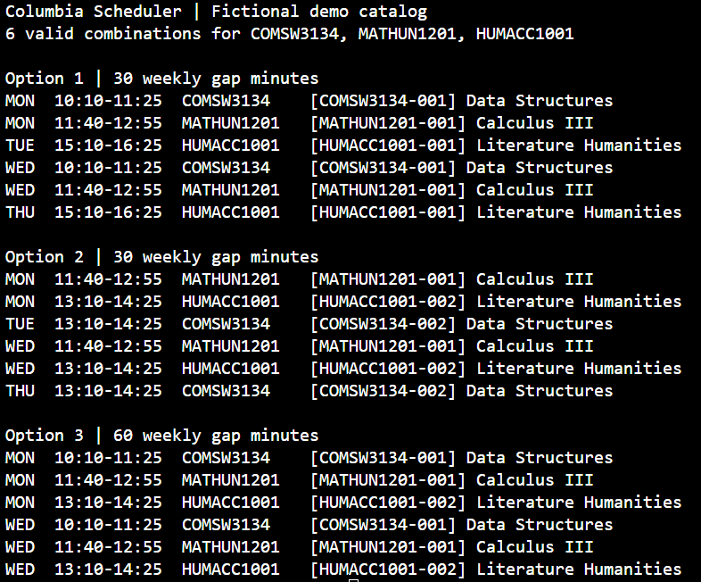

# Columbia Scheduler

A Java command-line planner for Columbia course sections. Give it a term and a list of courses, and it prints the three conflict-free schedules with the least time between classes. If the courses cannot fit together, it identifies a subset that explains the conflict.

## Demo

The scheduler generates conflict-free course schedules
and ranks them by weekly idle time.



## Run the demo

From the repository root with JDK 17 or newer:

```sh
sh tools/build.sh
java -jar build/scheduler.jar
```

The sample catalog has two sections each of Data Structures, Calculus III, and Literature Humanities. Six of the eight combinations fit. The first result puts Data Structures at 10:10 and Calculus III at 11:40 on Mondays and Wednesdays. That leaves two 15-minute breaks, or 30 minutes for the week.

To list courses or try a different combination:

```sh
java -jar build/scheduler.jar data/demo.tsv DEMO --list
java -jar build/scheduler.jar data/demo.tsv DEMO COMSW3134 MATHUN1201
```

## Use a Vergil export

The planner works offline with saved course-search results. Live Vergil integration pending! For now, save the JSON response body from your Vergil course search under `local/`. Only sections included in the export are available for planning. To try the import with the included synthetic response:

```sh
mkdir -p local
python3 tools/import_vergil.py data/vergil-example.json > local/catalog.tsv
java -jar build/scheduler.jar local/catalog.tsv 20263 --list
java -jar build/scheduler.jar local/catalog.tsv 20263 TESTUN2000
```

Use the listed component codes to request a lecture and lab separately. Check linked-section eligibility and seat availability in Vergil before registering.

## How schedules are ranked

The search starts with the course that has the fewest eligible sections. It chooses one section per course and abandons a partial schedule as soon as two meetings conflict. It counts all feasible combinations while retaining only the top three. Equal scores are ordered by section ID.

Back-to-back meetings can fit. For date-limited courses, a conflict requires an actual shared meeting day within both date ranges. Sections with unknown meeting times are excluded. The gap score uses a recurring weekly timetable, so a half-term course can affect the score even during weeks when it does not meet.

## Tests

After building the JAR, run:

```sh
python3 test/test_cli.py
```

The suite covers the CLI, Vergil conversion, meeting conflicts, and ranking. It also compares the planner against exhaustive enumeration on 25 generated catalogs.
